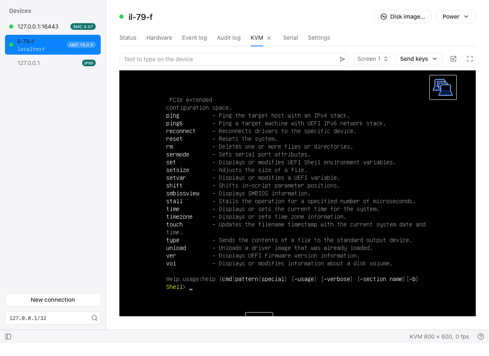
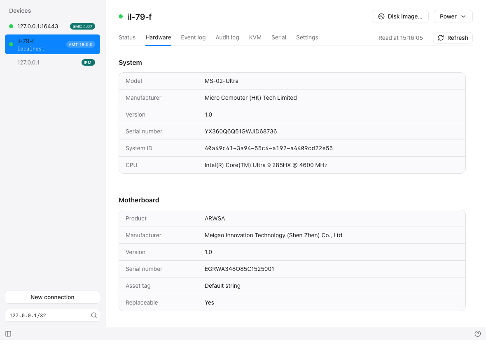
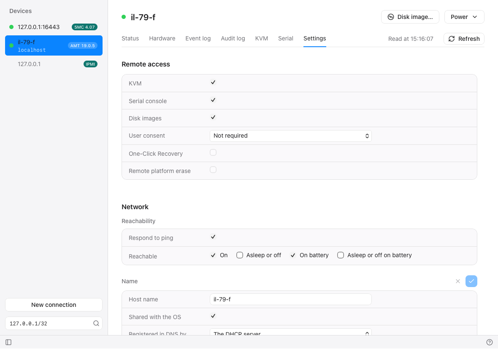
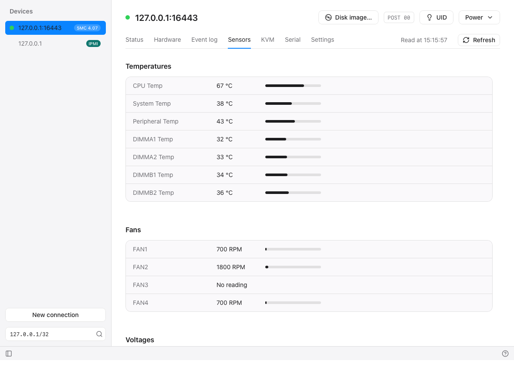
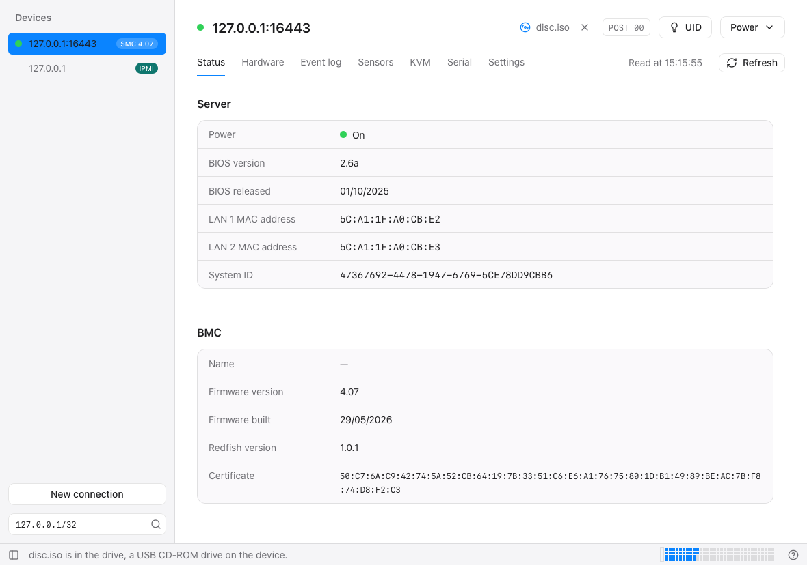

# Ooblin

Ooblin, the out-of-band (OOB) goblin, is a desktop console for Intel AMT, Supermicro BMCs and any BMC over IPMI or Redfish: power control, hardware inventory, the screen, keyboard and mouse of the device (KVM), its serial console, and booting it from a disk image on your machine.

The idea is that you do NOT need a server or a cloud for this. The app talks to your devices directly, over TLS with pinned certificates (and IPMI, encrypted with keys from its password), and keeps the passwords in the keychain of your OS. It is built with [Tauri](https://tauri.app) and runs on Linux, macOS and Windows.



| Its hardware                                   | Its settings                                   |
| ---------------------------------------------- | ---------------------------------------------- |
|  |  |

| The sensors of a Supermicro X10              | A disk image it reads, mapped at the bottom right  |
| -------------------------------------------- | -------------------------------------------------- |
|  |  |

## Running it for the first time

On macOS you install it with Homebrew, from the cask in this repository:

```sh
brew tap kevinvalk/ooblin https://github.com/kevinvalk/ooblin
brew install --cask ooblin
```

Anywhere else, download the build for your system from the [releases](https://github.com/kevinvalk/ooblin/releases): an installer for Windows, an AppImage, `.deb` or `.rpm` for Linux. "Unstable" is the latest build of main. Apple does not sign Ooblin yet, so on macOS you have to allow the app once in System Settings > Privacy & Security.

Ooblin looks for a newer release when it starts, and when you ask under Help in the status bar. It installs one the way you installed it and starts again, which closes every connection, so it waits for you to click Update.

Start it and fill in the host, user and password of your device. Or start it with a host to connect straight away, with its saved credentials or the ones you pass. If Ooblin is already running, the device opens in that one:

```sh
ooblin [host] [--user admin] [--password <password>]
```

Some things you want to know:

- You do not have to say what kind of device it is. Connecting tries Intel AMT first, then the Redfish of a Supermicro (asked without the password), then IPMI (whose login never sends the password), and then the Redfish that answered where IPMI does not. The Kind in the connect form picks one instead.
- A BMC whose web port is not 443 takes the port in the host, as `host:port`.
- We pin the certificate of a device the first time you connect. From then on a device that shows another certificate is refused until you trust the new one.
- Ooblin logs what it does and what goes wrong (a megabyte, and the one before it) in the log folder of your OS. Save log under Help in the status bar saves it for a bug report. It has the addresses and names of your devices, but NEVER a password.

## What it supports

- Intel AMT, as checked against an MS-02 (AMT 19): power and booting once elsewhere, hardware, KVM, serial console, disk images, user consent, the logs, the alarm clock, the network, certificates and the power policy.
- Supermicro BMCs, as checked against an X10 and an A2SDi: all of IPMI and Redfish below, plus the KVM, virtual media and the BMC's own settings.
- Any BMC over IPMI 2.0: power, sensors, the event log, the FRU, the serial console and the network.
- Any BMC over Redfish: power, hardware, the logs and sensors.

[docs/support.md](docs/support.md) says feature by feature what is there and what is not.

## Developing

You need the Rust of `rust-toolchain.toml`, the Node of `.node-version` and the [Tauri prerequisites](https://v2.tauri.app/start/prerequisites/). CI checks every pull request and main the same way on Linux, macOS and Windows.

```sh
cargo install tauri-cli --locked
npm install --prefix ui
cargo tauri dev            # or cargo tauri dev -- -- <host>
cargo test
cargo tauri build          # an app of your own, which says it is 0.0.0 and so is offered every release
```

`cargo test` runs the library against recorded devices and writes the types of the UI to `ui/src/bindings`, so commit those with your change. The rest is in `docs/`:

- [architecture.md](docs/architecture.md): how flavors (what a device is) and protocols (how we speak to it) fit together
- [mock-devices.md](docs/mock-devices.md): recording a device and replaying it, which is how we test without one
- [releasing.md](docs/releasing.md): a tag is the release
- [signing.md](docs/signing.md): the updater's key, and Apple and Microsoft to come
- `cargo screenshots` takes the screenshots above again, of the app against the mock devices (on macOS)

`AGENTS.md` has how the code is laid out and how we check a change in the running app.

## Current problems and ideas

- Apple and Microsoft do not sign Ooblin yet, only our updater does. We also want SHA-256 sums and a provenance attestation on the releases.
- An Arch Linux package (AUR) and winget for Windows, both published from the release job.
- Drives behind a Redfish storage controller and Redfish logs of more than a page are written by the standard alone, as no device we have lists either.
- We never saw a real X10 end a KVM session on its own, so the reasons we show for that are unverified.
- The AMT features that say "Partly" in [docs/support.md](docs/support.md), starting with the other boot options (the boots of One-Click Recovery among them), exporting and clearing the logs, the certificate of TLS and platform erase itself. Wi-Fi last.
- An optional built in PXE boot system, where our tool hosts the PXE server directly?!

## References

- [AMT Implementation and Reference Guide](https://software.intel.com/sites/manageability/AMT_Implementation_and_Reference_Guide/default.htm) and the [Device Management Toolkit](https://github.com/device-management-toolkit) of Intel
- [MeshCommander](https://github.com/Ylianst/MeshCommander), where the message layouts of the AMT redirection come from
- The IPMI 2.0 specification (second generation, v2.0 revision 1.1)
- [Redfish specification (DSP0266)](https://www.dmtf.org/standards/redfish) and the [Redfish-Mockup-Server](https://github.com/DMTF/Redfish-Mockup-Server) of DMTF
