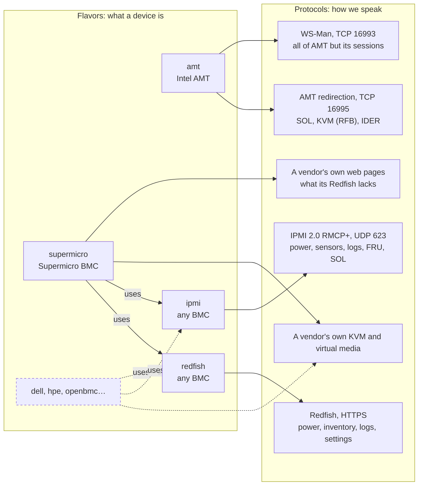

# Ooblin

Ooblin, the out-of-band (OOB) goblin, is a desktop console for Intel AMT, Supermicro BMCs and any BMC over IPMI or Redfish: power control, hardware inventory, the screen, keyboard and mouse of the device (KVM), its serial console, and booting it from a disk image on your machine.

The idea is that you do NOT need a server or a cloud for this. The app talks to your devices directly, over TLS with pinned certificates (and IPMI, encrypted with keys from its password), and keeps the passwords in the keychain of your OS. It is built with [Tauri](https://tauri.app) and runs on Linux, macOS and Windows.

## Running it for the first time

Download the build for your system from the [releases](https://github.com/kevinvalk/ooblin/releases). "Unstable" is the latest build of main. Nothing is signed yet, so on macOS you have to allow the app once in Privacy & Security.

Or build it yourself, with the tools from "Developing" below in place:

```sh
cargo tauri build
```

Start it and fill in the host, user and password of your device. Or start it with a host to connect straight away, with its saved credentials or the ones you pass. If Ooblin is already running, the device opens in that one:

```sh
ooblin [host] [--user admin] [--password <password>]
```

Some things you want to know:

- You do not have to say what kind of device it is. Connecting tries Intel AMT first, then the Redfish of a Supermicro (asked without the password), then IPMI (whose login never sends the password), and then the Redfish that answered where IPMI does not. The Kind in the connect form picks one instead.
- A BMC whose web port is not 443 takes the port in the host, as `host:port`.
- We pin the certificate of a device the first time you connect. From then on a device that shows another certificate is refused until you trust the new one.
- Ooblin logs what it does and what goes wrong (a megabyte, and the one before it) in the log folder of your OS. The button at the right of the status bar saves the log for a bug report. It has the addresses and names of your devices, but NEVER a password.

## Developing

You need the Rust of `rust-toolchain.toml`, the Node of `.node-version` and the [Tauri prerequisites](https://v2.tauri.app/start/prerequisites/). CI checks every pull request and main the same way on Linux, macOS and Windows.

```sh
cargo install tauri-cli --locked
npm install --prefix ui
cargo tauri dev            # or cargo tauri dev -- -- <host>
cargo test
```

`cargo test` runs the library against the mock devices below and writes the types of the UI to `ui/src/bindings`, so commit those with your change. `AGENTS.md` has the rest: how the code is laid out and how we check a change in the running app.

### Mock devices

AMT lives in the management engine of a real vPro machine and nobody makes an emulator for it. So we record real devices once and replay them from then on.

```sh
cargo run -p mock -- record <fixture> <host>   # asks for the password, writes fixtures/<fixture>
cargo run -p mock -- run <fixture>             # serves it on 127.0.0.1 as admin / P@ssw0rd
```

- `record` reads everything the device offers without changing anything: every WS-Man class it knows, the read-only methods the app uses (clock, accounts, event and audit log) and a short serial console, KVM and IDER session.
- `run` fills in by the spec what a recording cannot hold: handshakes, authentication, method results, enumeration pages (AMT keeps one context for all of them), a KVM screen that waits for the viewer to ask for each update and a serial console that waits for you to type.
- The mock hangs up on a client that says anything else than was recorded (except the keys and pointer between the updates of a screen, and what is typed on the console). That way every transcript checks our bytes.
- `cargo test` replays every fixture, so whatever a device once told us keeps parsing. It also replays each fixture with a few files garbled, so whatever a device says we neither crash nor wait forever (`GARBLED=500 cargo test --test garbled` tries more).
- `run` also takes a path, for a fixture of your own. `record <fixture> <host> --sol` records only the serial console for as long as you like: make the device write to it (mount a disk image, say), then press Enter.

A BMC is recorded the same way: its Redfish (scrubbed, in the mockup layout of DMTF under `redfish/`), its IPMI (scrubbed, every answer our reads asked for in `ipmi.txt`) and, for a Supermicro, a short KVM session. `run x10` serves it on 127.0.0.1:16443 next to an AMT fixture: Redfish, the web login that the token of the KVM comes from, the WebSocket of the KVM and the CGI of its dashboard (`cgi/`). On UDP 623 it answers IPMI as the recording does, and as a BMC does for what a recording cannot hold: logins, the chassis commands, and a serial console that greets with a login prompt and echoes what is typed. A fixture without an `ipmi.txt` is a BMC with IPMI off.

IMPORTANT: Fixtures are committed, so only record a device that has nothing to hide! Serials, addresses and names are scrubbed, but the audit log keeps its user names and client addresses, and the KVM session keeps a screenshot of whatever is on screen.

The fixtures that are not our own devices:

- `fixtures/go-wsman-messages` is an untouched copy of the sample responses of Intel from [go-wsman-messages](https://github.com/device-management-toolkit/go-wsman-messages) (`pkg/wsman/wsmantesting/responses` at `00402b9`, Apache-2.0), which the mock serves next to a fixture.
- `fixtures/ipmi-sim` is what the simulator of OpenIPMI, another IPMI 2.0 implementation, told ipmitool. `run ipmi-sim` serves a BMC that we know over IPMI alone.
- `fixtures/openbmc` is OpenBMC: the `obmc-phosphor-image-romulus.static.mtd` of its CI, booted in QEMU with the command below. We recorded its IPMI with `record openbmc 127.0.0.1 --user root` (0penBmc) and its Redfish at `127.0.0.1:2443`, where IPMI does not answer. So it is one fixture that a login finds over IPMI and that the Kind Redfish speaks to as well.
- `fixtures/dmtf-rackmount1` is an untouched copy of the sample rack server of DMTF from their [Redfish-Mockup-Server](https://github.com/DMTF/Redfish-Mockup-Server) (`public-rackmount1` at `23d21f9`, BSD-3-Clause, its license next to it): the own example of the standard, with IPMI off.

```sh
qemu-system-arm -M romulus-bmc -nographic \
  -drive file=obmc-phosphor-image-romulus.static.mtd,format=raw,if=mtd \
  -net nic -net user,hostfwd=udp::623-:623,hostfwd=tcp::2443-:443
```

## How it fits together

Out-of-band management is a few protocols and many dialects, and we keep the two apart. A flavor is what a device is (a folder or file of `crates/ooblin-core/src`), a protocol is how we speak to it (a file of its `net/`), and a flavor speaks the protocols that its device does. Dashed is what is not there yet.



Two flavors are a standard alone and work with the device of any vendor: `ipmi` and `redfish`. The flavor of a vendor is what the standards do not say (its KVM, its virtual media, its settings and quirks) on top of those. `supermicro` sits on both: power and what a server is made of through `redfish`, sensors and the FRU through `ipmi`, and the rest is its own.

So what belongs to a standard goes in the flavor of that standard, what belongs to one vendor goes in the flavor of that vendor, and nothing of a vendor is in `net/` but its own wire formats.

## What it supports

### Intel AMT

By the features in the [AMT Implementation and Reference Guide](https://software.intel.com/sites/manageability/AMT_Implementation_and_Reference_Guide/default.htm) of Intel, as checked against the MS-02 (AMT 19). "Partly" means some of it, see the notes.

| Feature                                      |        | Notes                                                                                                                                                                   |
| -------------------------------------------- | ------ | ----------------------------------------------------------------------------------------------------------------------------------------------------------------------- |
| Discovery, general info                      | Partly | Finding devices by RMCP ping, version, control mode, host name, certificate. Not: provisioning record, ME capabilities, privacy level.                                  |
| Hardware asset                               | Yes    | System, BIOS, processors, memory, disks, batteries. Not: FRU and media device tables.                                                                                   |
| Remote control (power, boot)                 | Partly | Every power action, booting once to BIOS, PXE, a disk image or with the BIOS on SOL. Not: the boots of One-Click Recovery, local boot sources, BIOS pause, input locks. |
| KVM                                          | Yes    | ZRLE and Raw, 16-bit and 8-bit beyond 4K as AMT wants, keyboard, mouse, typing text, full screen, picking a screen, frames a second. Not: KVM settings.                 |
| SOL                                          | Yes    | xterm.js at 80 by 25, Backspace sent as ^H like MeshCommander.                                                                                                          |
| Storage redirection (IDER)                   | Yes    | A CD-ROM from an ISO, the floppy left empty.                                                                                                                            |
| User consent                                 | Yes    | Choosing when it is needed, and asking for it: the device shows a code that someone there reads out.                                                                    |
| Redirection and KVM switches                 | Yes    | By hand in the settings, sessions open only what is on.                                                                                                                 |
| Event manager (event log)                    | Partly | Reading. Not: export, clear, freeze, filters, alerts, subscriptions.                                                                                                    |
| Access monitor (audit log)                   | Partly | Reading. Not: export, clear, lock, auditing on or off, policy.                                                                                                          |
| Alarm clock                                  | Yes    | Scheduling wake-ups (once, hourly, daily, weekly) and canceling them.                                                                                                   |
| Time synchronization                         | Yes    | Reading the clock, setting it to the one of this computer.                                                                                                              |
| Network administration                       | Partly | Wired IPv4 and IPv6, when it is reachable, the name, DNS registration, ping. Not: wireless.                                                                             |
| Wi-Fi port configuration                     | No     |                                                                                                                                                                         |
| 802.1X profiles                              | No     |                                                                                                                                                                         |
| Access control list (users)                  | No     | Left to the own web pages of AMT, which we link to.                                                                                                                     |
| Certificate management                       | Partly | Listing, adding certificates and trusted roots, saving, deleting. Not: keys, signing requests.                                                                          |
| Transport layer security                     | Partly | TLS only, pinned, its settings shown. Not: changing them or its certificate.                                                                                            |
| Remote platform erase                        | Partly | Turning it and One-Click Recovery on and off where the BIOS allows. Not: erasing (neither on the MS-02).                                                                |
| Environment detection                        | No     |                                                                                                                                                                         |
| Kerberos                                     | No     | Not planned.                                                                                                                                                            |
| Remote access (CIRA), Fast Call for Help     | No     | Not planned: needs a server.                                                                                                                                            |
| WS-Eventing, alerts                          | No     | Not planned: needs a listener.                                                                                                                                          |
| System defense, agent presence               | No     | Not planned.                                                                                                                                                            |
| Power packages (power policy)                | Yes    | Choosing which of the packages of the maker the device uses, and how long AMT stays awake after.                                                                        |
| Third-party storage, web application hosting | No     | Not planned: deprecated.                                                                                                                                                |

### Supermicro BMCs

Through Redfish, the own web pages and HTML5 KVM of the BMC, and IPMI 2.0, as checked against an X10 (BMC firmware 4.07):

- status, with the dates of the firmware and the BIOS and the LAN ports of the server
- power, with booting once to BIOS, PXE or a disk image
- the identify light (UID) and the POST code
- hardware and the event log
- sensors (temperatures, fans, voltages, power supplies) every second, read over IPMI as that is five times as fast as the Redfish of the X10
- the KVM, with keyboard, mouse and typing text
- the serial console (SOL)
- a disk image on your machine as a USB CD-ROM drive (the virtual media of the HTML5 viewer)
- settings: fan and mouse mode, NTP, syslog, what the server does when power comes back, the speed of the serial console, its services (each on or off and on which port, except IPMI and HTTPS as we speak those) and its network (host name, DHCP or its addresses, DNS server and VLAN)

Not: users (left to the own web pages of the BMC, which we link to), or anything that needs a Supermicro license.

### Any BMC, over IPMI 2.0

Whoever made it (Dell, HPE, Lenovo, ASRock Rack, Gigabyte, OpenBMC, a Supermicro without Redfish), over IPMI alone (RMCP+ on UDP 623, SHA-256 or SHA-1 with AES), as checked against the X10, OpenBMC and the simulator of OpenIPMI:

- the maker, firmware and network port of the BMC
- power, with booting once to BIOS or PXE, and the identify light
- sensors from its SDR (every second) and the event log in words
- its FRU as hardware
- the serial console (SOL)
- settings: its network (DHCP or its addresses, and VLAN), what the server does when power comes back, the speed of the serial console, the chassis, board and product fields of the FRU (rewritten in place and checked by reading them back), and its users to read

Not: a screen or virtual media, as IPMI has neither and every vendor has its own.

### Any BMC, over Redfish

Whoever made it, where IPMI is off or you would rather not speak it, as far as the standard goes (DSP0266), as checked against OpenBMC and the sample server of DMTF:

- the first server, BMC and chassis that its service lists
- status, with the network port of the BMC and those of the server
- power, with booting once to BIOS or PXE (what its Reset allows, where it says so in the action or in a resource of its own)
- the identify light, under either of its names
- hardware: processors, memory, and disks from its storage controllers or simple storage
- the logs of the server
- sensors, each a resource of its own or as its thermal and power resources say them

Not: a screen, a serial console or virtual media (every vendor has its own), nor settings.

## Current problems and ideas

- Nothing is signed. We also want SHA-256 sums and a provenance attestation on the releases.
- Drives behind a Redfish storage controller and Redfish logs of more than a page are written by the standard alone, as no device we have lists either.
- We never saw a real X10 end a KVM session on its own, so the reasons we show for that are unverified.
- We should build from a fresh clone on macOS, Linux and Windows.
- The AMT features above that say "Partly", starting with the other boot options (the boots of One-Click Recovery among them), exporting and clearing the logs, the certificate of TLS and platform erase itself. Wi-Fi last.
- An optional built in PXE boot system, where our tool hosts the PXE server directly?!

## References

- [AMT Implementation and Reference Guide](https://software.intel.com/sites/manageability/AMT_Implementation_and_Reference_Guide/default.htm) and the [Device Management Toolkit](https://github.com/device-management-toolkit) of Intel
- [MeshCommander](https://github.com/Ylianst/MeshCommander), where the message layouts of the AMT redirection come from
- The IPMI 2.0 specification (second generation, v2.0 revision 1.1)
- [Redfish specification (DSP0266)](https://www.dmtf.org/standards/redfish) and the [Redfish-Mockup-Server](https://github.com/DMTF/Redfish-Mockup-Server) of DMTF
- [Tauri prerequisites](https://v2.tauri.app/start/prerequisites/)
