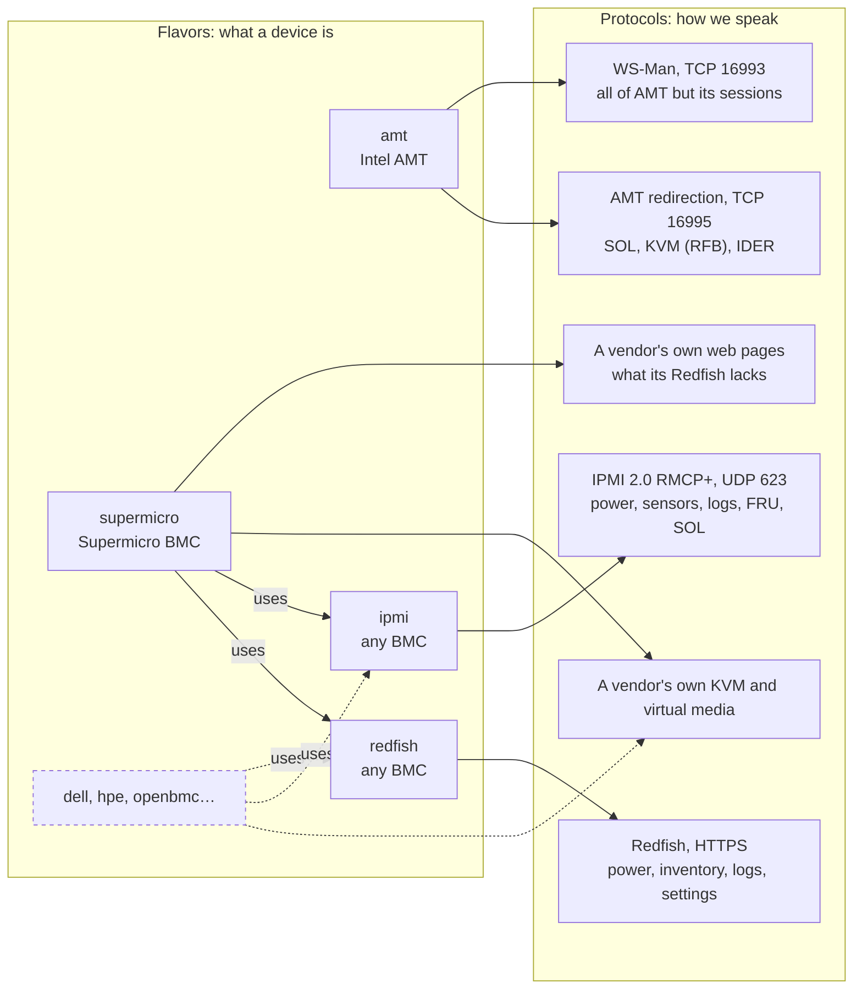

# How it fits together

Out-of-band management is a few protocols and many dialects, and we keep the two apart. A flavor is what a device is (a folder or file of `crates/ooblin-core/src`), a protocol is how we speak to it (a file of its `net/`), and a flavor speaks the protocols that its device does. Dashed is what is not there yet.

Two flavors are a standard alone and work with the device of any vendor: `ipmi` and `redfish`. The flavor of a vendor is what the standards do not say (its KVM, its virtual media, its settings and quirks) on top of those. `supermicro` sits on both: power and what a server is made of through `redfish`, sensors and the FRU through `ipmi`, and the rest is its own.

So what belongs to a standard goes in the flavor of that standard, what belongs to one vendor goes in the flavor of that vendor, and nothing of a vendor is in `net/` but its own wire formats.

The app (`crates/ooblin`) is Tauri around that library, and the UI (`ui/`) is Svelte. Only `net/` reaches a device, and the one other way onto the network is the app's updater, which asks our releases on GitHub (see [releasing](releasing.md)).
